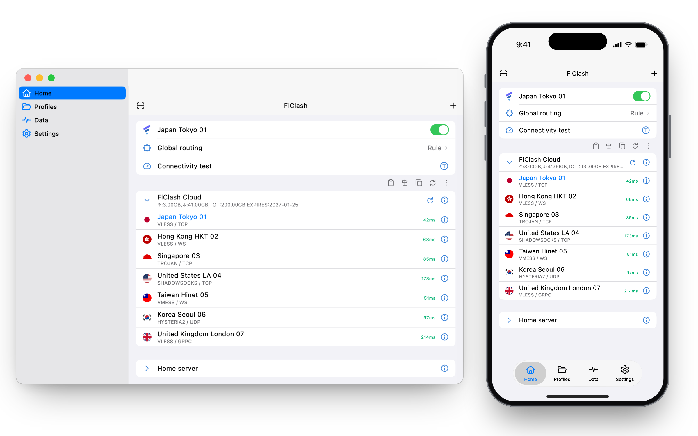

<div align="center">


# FlClash

基于 Xray-core 的多平台代理客户端，简单易用，开源无广告。

[English](README.md) · **简体中文**

[](https://github.com/wyusgw/FlClash/releases/latest)
[](https://github.com/wyusgw/FlClash/releases)
[](LICENSE)

[下载](#下载) · [更新日志](CHANGELOG.md) · [从源码构建](#从源码构建)

</div>

<p align="center">
  <picture>
    <source media="(prefers-color-scheme: dark)" srcset="snapshots/preview-dark.png">
    
  </picture>
</p>

## 功能

- **一个应用覆盖 Android、Windows、macOS 和 Linux**，桌面端同时提供 x64 与 ARM64 版本。
- **Xray-core 内核**：规则分流、节点组、延迟测试、系统代理与 TUN 模式。
- **配置管理**：通过订阅链接或文件导入配置（分享链接、base64 列表或 Xray 配置，支持 VLESS、VMess、Trojan、Shadowsocks、Hysteria2、TUIC 与 AnyTLS），内置编辑器。
- **实时查看**流量、延迟和日志。
- **Material You 设计**：支持动态取色、浅色与深色主题，布局随屏幕从手机到桌面自适应。
- **备份与恢复**：通过 WebDAV 或本地文件。
- **平台细节**：Android 上有快捷设置磁贴、分应用代理和 Android TV 支持；桌面端有托盘菜单和全局快捷键。
- **开源无广告**，以 GPL-3.0 协议发布。

## 下载

从 [GitHub Releases](https://github.com/wyusgw/FlClash/releases/latest) 获取最新版本。

### 按系统下载

打开最新版本，选择与你系统对应的文件。下表中的 `<version>` 是版本号，例如 `0.9.3`。

| 你的系统 | 下载的文件 | 说明 |
| --- | --- | --- |
| Android 手机或平板（绝大多数设备） | `FlClash-<version>-android-arm64-v8a.apk` | 老旧的 32 位设备选 `armeabi-v7a`，模拟器或 x86 设备选 `x86_64`。 |
| Windows 10 及以上，Intel 或 AMD | `FlClash-<version>-windows-amd64-setup.exe` | 也可下载便携版 `FlClash-<version>-windows-amd64.zip`。 |
| Windows on ARM（骁龙等笔记本） | `FlClash-<version>-windows-arm64-setup.exe` | 也可下载便携版 `FlClash-<version>-windows-arm64.zip`。 |
| macOS 12 及以上，Apple Silicon | `FlClash-<version>-macos-arm64.dmg` | M1 及更新的芯片。 |
| macOS 12 及以上，Intel | `FlClash-<version>-macos-amd64.dmg` | |
| Linux，x64 | `FlClash-<version>-linux-amd64.deb`、`.rpm` 或 `.AppImage` | Debian、Ubuntu 选 `.deb`，Fedora 选 `.rpm`。托盘依赖见下方说明。 |
| Linux，ARM64 | `FlClash-<version>-linux-arm64.deb`、`.rpm` 或 `.AppImage` | |

发布页上的 `SHA256SUMS` 列出了每个文件的校验值。

<p>
  <a href="https://github.com/wyusgw/FlClash/releases/latest"></a>
</p>

**Linux 托盘图标**

`.deb` 安装包会自动安装所需依赖。使用 AppImage 或 `.rpm` 时，需要先安装 AyatanaAppIndicator 库，托盘图标才能显示：

```bash
sudo apt-get install libayatana-appindicator3-1   # Debian 与 Ubuntu
sudo dnf install libayatana-appindicator-gtk3     # Fedora
```

## 使用

**通过链接导入配置。** 打开下面格式的链接，即可把订阅导入 FlClash。`clashmeta://` 和 `flclash://` 开头的链接同样可用。

```text
clash://install-config?url=<经过 URL 编码的订阅链接>
```

**Android 自动化。** Tasker、MacroDroid 等应用可以用下面的 Action 启动 Activity，从而启动、停止或切换代理：

```text
com.follow.clash.action.START
com.follow.clash.action.STOP
com.follow.clash.action.TOGGLE
```

在电脑上也可以通过 adb 触发：

```bash
adb shell am start -a com.follow.clash.action.TOGGLE
```

## 从源码构建

需要 [Flutter](https://docs.flutter.dev/get-started/install) 3.47（正式版构建使用 3.47.4）、[Go](https://go.dev/dl/) 1.27，
以及通过 rustup 安装的 [Rust](https://rustup.rs/)。桌面端需要在对应系统上构建，Android 在任意系统上都能构建。

```bash
git clone --recursive https://github.com/wyusgw/FlClash.git
cd FlClash
flutter pub get
dart setup.dart android   # 或 windows、macos、linux
```

安装包输出到 `dist/`。Go 内核和 Rust 库会在 Flutter 构建过程中一并编译。

| 平台 | 额外依赖 |
| --- | --- |
| Android | 带 NDK 的 Android SDK。加上 `--arch arm64` 可以只构建单个 ABI。 |
| Windows | 编译内核用的 GCC（MinGW-w64），以及打包安装程序用的 [Inno Setup](https://jrsoftware.org/isinfo.php) 6。 |
| macOS | Xcode 与 Node.js。脚本会通过 npm 安装 `appdmg`。 |
| Linux | Debian 或 Ubuntu。脚本会用 apt 安装构建所需的软件包，并下载 `appimagetool`。 |

其余选项可以运行 `dart setup.dart --help` 查看，例如用 `--targets` 只构建部分安装包格式。

## 支持

给仓库点一个 Star 是支持项目最简单的方式。Bug 与功能建议请提交到 [GitHub Issues](https://github.com/wyusgw/FlClash/issues)。

<a href="https://star-history.com/#wyusgw/FlClash&Date">
  <picture>
    <source media="(prefers-color-scheme: dark)" srcset="https://api.star-history.com/svg?repos=wyusgw/FlClash&type=Date&theme=dark">
    
  </picture>
</a>

## 许可证

FlClash 以 [GPL-3.0 协议](LICENSE)发布。
