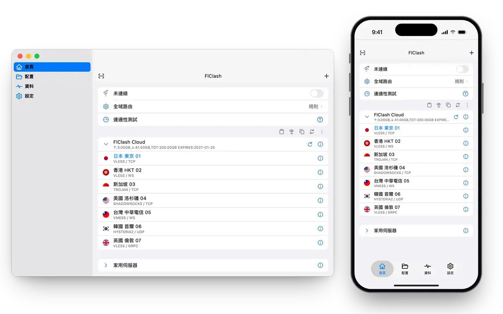

<div align="center">


# FlClash

基於 Xray-core 的多平台代理客戶端，簡單易用，開源無廣告。

[English](README.md) · [简体中文](README_zh_CN.md) · **繁體中文**

[](https://github.com/wyusgw/FlClash/releases/latest)
[](https://github.com/wyusgw/FlClash/releases)
[](LICENSE)

[下載](#下載) · [更新日誌](CHANGELOG.md) · [從原始碼建置](#從原始碼建置)

</div>

<p align="center">
  <picture>
    <source media="(prefers-color-scheme: dark)" srcset="snapshots/demo-zh-tw-dark.webp">
    
  </picture>
</p>

## 功能

- **一個應用覆蓋 Android、Windows、macOS 和 Linux**，桌面端同時提供 x64 與 ARM64 版本。
- **Xray-core 核心**：規則分流、節點組、延遲測試、系統代理與 TUN 模式。
- **配置管理**：透過訂閱連結或檔案匯入配置（分享連結、base64 列表或 Xray 配置，支援 VLESS、VMess、Trojan、Shadowsocks、Hysteria2、TUIC 與 AnyTLS），內建編輯器。
- **即時檢視**流量、延遲和日誌。
- **Material You 設計**：支援動態取色、淺色與深色主題，佈局隨螢幕從手機到桌面自適應。
- **備份與恢復**：透過 WebDAV 或本機檔案。
- **平台細節**：Android 上有快捷設定磁貼、分應用代理和 Android TV 支援；桌面端有系統匣選單和全域快捷鍵。
- **開源無廣告**，以 GPL-3.0 授權發佈。

## 下載

從 [GitHub Releases](https://github.com/wyusgw/FlClash/releases/latest) 獲取最新版本。

### 自動識別系統並下載

<p align="center">
  <a href="https://wyusgw.github.io/FlClash/download/?lang=zh"></a>
</p>

點選按鈕會自動識別你的作業系統和 CPU，並直接開始下載對應的安裝檔。
[下載頁](https://wyusgw.github.io/FlClash/zh#download)列出所有檔案，並優先給出合適的一個。不確定該選哪個檔案時可以用它們。

### 按系統下載

點選與你係統對應的按鈕。絕大多數 Android 手機選 ARMv8，驍龍等 ARM 架構的 Windows 筆記本選 ARM64，M 系列晶片的 Mac 選
Apple Silicon。按鈕始終下載最新版本，[發佈頁](https://github.com/wyusgw/FlClash/releases/latest)上的 `SHA256SUMS`
列出了每個檔案的校驗值。

<table>
  <thead align="left">
    <tr><th>系統</th><th>下載</th></tr>
  </thead>
  <tbody align="left">
    <tr>
      <td>Android</td>
      <td>
        <a href="https://github.com/wyusgw/FlClash/releases/latest/download/FlClash-android-arm64-v8a.apk"></a>
        <a href="https://github.com/wyusgw/FlClash/releases/latest/download/FlClash-android-armeabi-v7a.apk"></a>
        <a href="https://github.com/wyusgw/FlClash/releases/latest/download/FlClash-android-x86_64.apk"></a>
      </td>
    </tr>
    <tr>
      <td>Windows</td>
      <td>
        <a href="https://github.com/wyusgw/FlClash/releases/latest/download/FlClash-windows-amd64-setup.exe"></a>
        <a href="https://github.com/wyusgw/FlClash/releases/latest/download/FlClash-windows-amd64.zip"></a>
        <a href="https://github.com/wyusgw/FlClash/releases/latest/download/FlClash-windows-arm64-setup.exe"></a>
        <a href="https://github.com/wyusgw/FlClash/releases/latest/download/FlClash-windows-arm64.zip"></a>
      </td>
    </tr>
    <tr>
      <td>macOS</td>
      <td>
        <a href="https://github.com/wyusgw/FlClash/releases/latest/download/FlClash-macos-arm64.dmg"></a>
        <a href="https://github.com/wyusgw/FlClash/releases/latest/download/FlClash-macos-amd64.dmg"></a>
      </td>
    </tr>
    <tr>
      <td>Linux</td>
      <td>
        <a href="https://github.com/wyusgw/FlClash/releases/latest/download/FlClash-linux-amd64.AppImage"></a>
        <a href="https://github.com/wyusgw/FlClash/releases/latest/download/FlClash-linux-amd64.deb"></a>
        <a href="https://github.com/wyusgw/FlClash/releases/latest/download/FlClash-linux-amd64.rpm"></a>
        <a href="https://github.com/wyusgw/FlClash/releases/latest/download/FlClash-linux-arm64.AppImage"></a>
        <a href="https://github.com/wyusgw/FlClash/releases/latest/download/FlClash-linux-arm64.deb"></a>
        <a href="https://github.com/wyusgw/FlClash/releases/latest/download/FlClash-linux-arm64.rpm"></a>
      </td>
    </tr>
  </tbody>
</table>

**Linux 系統匣圖示**

`.deb` 安裝檔會自動安裝所需依賴。使用 AppImage 或 `.rpm` 時，需要先安裝 AyatanaAppIndicator 函式庫，系統匣圖示才能顯示：

```bash
sudo apt-get install libayatana-appindicator3-1   # Debian 與 Ubuntu
sudo dnf install libayatana-appindicator-gtk3     # Fedora
```

## 使用

**透過連結匯入配置。** 開啟下面格式的連結，即可把訂閱匯入 FlClash。`clashmeta://` 和 `flclash://` 開頭的連結同樣可用。

```text
clash://install-config?url=<經過 URL 編碼的訂閱連結>
```

**Android 自動化。** Tasker、MacroDroid 等應用可以用下面的 Action 啟動 Activity，從而啟動、停止或切換代理：

```text
com.flclash.action.START
com.flclash.action.STOP
com.flclash.action.TOGGLE
```

在電腦上也可以透過 adb 觸發：

```bash
adb shell am start -a com.flclash.action.TOGGLE
```

## 從原始碼建置

需要 [Flutter](https://docs.flutter.dev/get-started/install) 3.47（正式版建置使用 3.47.4）、[Go](https://go.dev/dl/) 1.27，
以及透過 rustup 安裝的 [Rust](https://rustup.rs/)。桌面端需要在對應系統上建置，Android 在任意系統上都能建置。

```bash
git clone --recursive https://github.com/wyusgw/FlClash.git
cd FlClash
flutter pub get
dart setup.dart android   # 或 windows、macos、linux
```

安裝檔輸出到 `dist/`。Go 核心和 Rust 函式庫會在 Flutter 建置過程中一併編譯。

| 平台 | 額外依賴 |
| --- | --- |
| Android | 帶 NDK 的 Android SDK。加上 `--arch arm64` 可以只建置單個 ABI。 |
| Windows | 編譯核心用的 GCC（MinGW-w64），以及打包安裝程式用的 [Inno Setup](https://jrsoftware.org/isinfo.php) 6。 |
| macOS | Xcode 與 Node.js。腳本會透過 npm 安裝 `appdmg`。 |
| Linux | Debian 或 Ubuntu。腳本會用 apt 安裝建置所需的套件，並下載 `appimagetool`。 |

其餘選項可以執行 `dart setup.dart --help` 檢視，例如用 `--targets` 只建置部分安裝檔格式。

## 文件

線上閱讀：<https://wyusgw.github.io/FlClash/zh/docs/>，或直接檢視儲存庫中的檔案：

- [使用指南](docs/user-guide.zh-TW.md)：新增伺服器、路由規則、DNS、虛擬網路卡、快捷鍵、備份與常見問題。
- [貢獻指南](CONTRIBUTING.md)：建置、測試、提交資訊與發佈流程（英文）。
- [架構說明](docs/architecture.md)：應用、Go 核心與原生服務如何配合（英文）。

## 支援

給儲存庫點一個 Star 是支援專案最簡單的方式。Bug 與功能建議請提交到 [GitHub Issues](https://github.com/wyusgw/FlClash/issues)。

<a href="https://star-history.com/#wyusgw/FlClash&Date">
  <picture>
    <source media="(prefers-color-scheme: dark)" srcset="https://api.star-history.com/svg?repos=wyusgw/FlClash&type=Date&theme=dark">
    
  </picture>
</a>

## 授權

FlClash 以 [GPL-3.0 授權](LICENSE)發佈。
