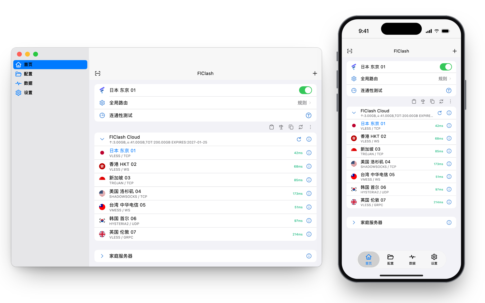

# 使用指南

[English](user-guide.md) · **简体中文** · [繁體中文](user-guide.zh-TW.md)

<p align="center">
  <picture>
    <source media="(prefers-color-scheme: dark)" srcset="../snapshots/preview-zh-dark.png">
    
  </picture>
</p>

本指南从第一次启动讲到最常用的设置。界面名称按应用内的简体中文显示。安装方法见
[下载](../README_zh_CN.md#下载)。

应用有四个标签页：**首页**、**配置**、**数据**和**设置**。手机上它们在底部，桌面端在侧边栏。

## 添加服务器

FlClash 至少需要一个服务器才能连接。打开 **数据 → 添加配置**（或在空的首页点 **添加配置**），选择添加方式：

| 类型 | 需要提供 |
| --- | --- |
| 订阅 | 订阅 URL，或 Xray JSON 配置 |
| 二维码 | 扫描二维码，或选择含有二维码的图片 |
| 文件 | 含分享链接的文件、base64 列表或 Xray 配置 |

也可以手动添加单个服务器：**首页 → 添加节点** 会按你选的协议打开表单（VLESS、VMess、Trojan、Shadowsocks、
Hysteria 与 Hysteria2、TUIC、AnyTLS、SOCKS、HTTP 和 Mieru），**粘贴** 可以导入剪贴板里的分享链接。

从浏览器或其他应用打开下面形式的链接，就能导入订阅，`clashmeta://` 和 `flclash://` 协议的用法相同：

```text
clash://install-config?url=<URL 编码后的订阅链接>
```

在 **数据 → 服务器节点** 中：

- **覆盖现有**：遇到同名服务器时替换，而不是两个都保留。
- **自动重命名**：给重复的名称加上编号，让每个服务器都保留在列表里。
- **导出文件** 保存你的服务器，**删除所有节点** 清空它们。

## 连接并选择服务器

**首页** 按订阅分组列出服务器。点订阅可以折叠或展开它的节点，点节点即可使用。首页上的代理开关用来启动和停止代理。

**全局路由** 决定哪些流量走代理：

| 模式 | 效果 |
| --- | --- |
| 规则 | 流量按路由规则转发，没有规则匹配的流量走代理 |
| 全局 | 所有流量都走代理 |
| 直连 | 所有流量都不走代理 |

**连通性测试** 测量节点的延迟。**延迟测试方法** 决定怎么测：*TCP* 测量到服务器的连接耗时，*CONNECT* 通过服务器发出请求，
测的是完整链路。代理关闭时也可以测试。

## 路由规则

**配置** 标签页里是规则配置。内置配置让中国大陆的域名和地址直连，其余走代理。圆点代表默认配置，复选标记代表正在使用的配置。

- **添加规则配置**（加号按钮）会新建一个空配置。URL 留空就手动填写规则；也可以给一个 URL 或文件，内容为 Xray 路由规则：
  完整配置、其中的 `routing` 对象，或规则列表。
- 进入某个配置后，点加号添加规则：选择 **匹配类型**（域名后缀、完整域名、域名关键字、域名正则、GeoSite、IP-CIDR、GeoIP 或端口），
  输入值（多个用逗号分隔），再选择 **策略**（代理、直连或封锁）。规则从上往下依次匹配。
- **测试规则** 告诉你某个域名或 IP 地址会命中哪条规则。
- **恢复默认配置** 会还原内置规则。

规则只在规则模式下生效。

## DNS

**设置 → DNS** 有两种模式。**自动** 使用默认服务器；**手动** 可以编辑两个列表，一个给走代理的流量，一个给直连的流量。
列表里的第一个服务器最先被查询。

| 列表 | 默认值 |
| --- | --- |
| 代理 DNS | `1.1.1.1`、`8.8.8.8` |
| 直连 DNS | `223.5.5.5`、`119.29.29.29` |

服务器可以是 IP 地址（可带端口）、`localhost`，或者形如 `https://dns.google/dns-query`、`tcp://8.8.8.8:53`、
`quic+local://dns.alidns.com` 的 URL。点 **保存** 之前不会应用任何更改。

## 系统代理、虚拟网卡和网络

在 **设置 → 网络** 中：

- **系统代理** 把操作系统的代理设置指向 FlClash。开启认证时不会应用。
- **虚拟网卡（TUN）** 通过虚拟网卡接管所有流量，仅在管理员模式下有效。

在 **设置 → 常规** 的 **入站** 分组里有代理监听的 **混合端口**、让局域网内其他设备使用代理的 **局域网代理**，以及给代理加上
用户名和密码的 **认证**。**日志等级** 也在这里。

在 Android 上，**设置 → 访问控制** 决定哪些应用走 VPN：白名单（只有选中的应用）或黑名单（除选中的应用外都走）。

## 网络检测与统计

**数据 → 网络检测** 显示你的流量出口地址。点开可以看到详情：网络类型、所属机构，以及 0 到 100 的纯净度。纯净度由网络类型
（住宅和手机最高，机房较低）以及针对该地址的代理、VPN、Tor 和滥用标记推算而来，仅供粗略参考。在手机上下拉页面可以重新查询。
**隐藏 IP** 会遮住地址。

**数据 → 统计** 显示流量统计。

## 日志

**数据 → 日志** 列出内核报告的内容，最新的在底部。点击等级标签可以按等级筛选，搜索可以缩小范围，导出按钮把日志保存为文件。
**设置 → 常规 → 日志等级** 决定记录多少内容。

## 快捷键

在桌面端，**设置 → 快捷键管理** 可以绑定全局快捷键，窗口隐藏时也能用。点一个操作，再按下你想要的组合键；点叉号可以清除。

新安装默认是：

| 操作 | macOS 和 Linux | Windows |
| --- | --- | --- |
| 显示/隐藏 | Ctrl+Alt+V | Ctrl+Alt+Shift+V |
| 启动/停止 | Ctrl+Alt+S | Ctrl+Alt+Shift+S |
| 切换模式 | Ctrl+Alt+M | Ctrl+Alt+Shift+M |
| 规则模式 / 全局模式 / 直连模式 | Ctrl+Alt+R / G / I | Ctrl+Alt+Shift+R / G / I |
| 系统代理 | Ctrl+Alt+P | Ctrl+Alt+Shift+P |
| 测试全部延迟 | Ctrl+Alt+D | Ctrl+Alt+Shift+D |
| 虚拟网卡 | Ctrl+Alt+T | Ctrl+Alt+Shift+T |
| 更新全部配置 | Ctrl+Alt+U | Ctrl+Alt+Shift+U |
| 复制环境变量 | Ctrl+Alt+C | Ctrl+Alt+Shift+C |
| 切换速度检视 | Ctrl+Alt+F | Ctrl+Alt+Shift+F |
| 退出 | Ctrl+Alt+E | Ctrl+Alt+Shift+E |

在 macOS 上，Ctrl 是 Control 键，Alt 是 Option 键。Windows 多一个 Shift，是因为它把 AltGr 当作 Ctrl+Alt。页面底部的
**重置快捷键** 会恢复默认值。

## 备份与恢复

**数据 → 备份与恢复** 把数据保存到 WebDAV 服务器或本地文件。先绑定 WebDAV 账号。**恢复策略** 可以选择仅恢复配置文件，
或恢复所有数据。

## 启动、托盘和更新

- **设置 → 常规** 里有 **自启动**、**静默启动**（启动时不显示窗口）和 **自动运行**（应用打开时自动运行）。
  **按需运行** 用来为特定场景配置应用的运行状态。
- 在 macOS 上，菜单栏会显示网速，菜单的条目和其他桌面系统的托盘一致。菜单里的 **切换速度检视** 可以显示或隐藏网速。
- **自动检查更新** 在应用启动时查找新版本，**设置 → 关于 → 检查更新** 则按需检查。
  <https://wyusgw.github.io/FlClash/zh> 的下载页会为你的系统挑选合适的安装包。

## 常见问题

- **按域名添加的服务器连不上，同一个服务器换成 IP 却可以。** 请使用最新版本：内核现在通过自己的 DNS 解析服务器域名，
  旧版本会跳过这一步。
- **开启虚拟网卡后什么都连不上。** 请以管理员权限运行 FlClash，并确认没有其他 VPN 或代理工具同时接管流量。
- **其他设备无法使用代理。** 打开 **局域网代理**，并在防火墙中放行 **混合端口**。
- **连接失败或 VPN 异常。** **设置 → 重置 → 重置内核设置** 会把核心、网络和 VPN 设置恢复为默认值。
- **需要反馈问题。** 在 **数据 → 日志** 中导出日志，附在 [GitHub](https://github.com/wyusgw/FlClash/issues) 的 issue 里。
