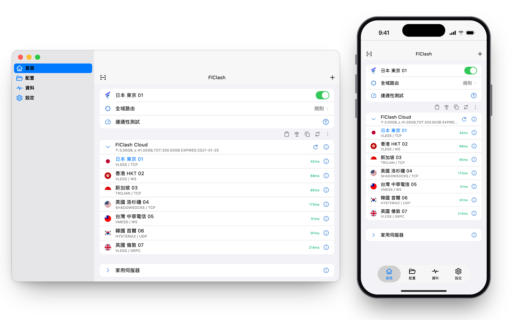

# 使用指南

[English](user-guide.md) · [简体中文](user-guide.zh-CN.md) · **繁體中文**

<p align="center">
  <picture>
    <source media="(prefers-color-scheme: dark)" srcset="../snapshots/preview-zh-tw-dark.png">
    
  </picture>
</p>

本指南從第一次啟動講到最常用的設定。介面名稱按應用內的繁體中文顯示。安裝方法見
[下載](../README_zh_TW.md#下載)。

應用有四個標籤頁：**首頁**、**配置**、**資料**和**設定**。手機上它們在底部，桌面端在側邊欄。

## 新增伺服器

FlClash 至少需要一個伺服器才能連線。開啟 **資料 → 新增配置**（或在空的首頁點 **新增配置**），選擇新增方式：

| 類型 | 需要提供 |
| --- | --- |
| 訂閱 | 訂閱 URL，或 Xray JSON 配置 |
| 二維碼 | 掃描二維碼，或選擇含有二維碼的圖片 |
| 檔案 | 含分享連結的檔案、base64 列表或 Xray 配置 |

也可以手動新增單個伺服器：**首頁 → 新增節點** 會按你選的協定開啟表單（VLESS、VMess、Trojan、Shadowsocks、
Hysteria 與 Hysteria2、TUIC、AnyTLS、SOCKS、HTTP 和 Mieru），**貼上** 可以匯入剪貼簿裡的分享連結。

從瀏覽器或其他應用開啟下面形式的連結，就能匯入訂閱，`clashmeta://` 和 `flclash://` 協定的用法相同：

```text
clash://install-config?url=<URL 編碼後的訂閱連結>
```

在 **資料 → 伺服器節點** 中：

- **覆蓋現有**：遇到同名伺服器時替換，而不是兩個都保留。
- **自動重新命名**：給重複的名稱加上編號，讓每個伺服器都保留在列表裡。
- **匯出檔案** 儲存你的伺服器，**刪除所有節點** 清空它們。

## 連線並選擇伺服器

**首頁** 按訂閱分組列出伺服器。點訂閱可以摺疊或展開它的節點，點節點即可使用。首頁上的代理開關用來啟動和停止代理。

**全域路由** 決定哪些流量走代理：

| 模式 | 效果 |
| --- | --- |
| 規則 | 流量按路由規則轉發，沒有規則匹配的流量走代理 |
| 全域 | 所有流量都走代理 |
| 直連 | 所有流量都不走代理 |

**連通性測試** 測量節點的延遲。**延遲測試方法** 決定怎麼測：*TCP* 測量到伺服器的連線耗時，*CONNECT* 透過伺服器發出請求，
測的是完整鏈路。代理關閉時也可以測試。

## 路由規則

**配置** 標籤頁裡是規則配置。內建配置讓中國大陸的域名和位址直連，其餘走代理。圓點代表預設配置，複選標記代表正在使用的配置。

- **新增規則配置**（加號按鈕）會新建一個空配置。URL 留空就手動填寫規則；也可以給一個 URL 或檔案，內容為 Xray 路由規則：
  完整配置、其中的 `routing` 物件，或規則列表。
- 進入某個配置後，點加號新增規則：選擇 **匹配類型**（域名後綴、完整域名、域名關鍵字、域名正則、GeoSite、IP-CIDR、GeoIP 或埠），
  輸入值（多個用逗號分隔），再選擇 **策略**（代理、直連或封鎖）。規則從上往下依次匹配。
- **測試規則** 告訴你某個域名或 IP 位址會命中哪條規則。
- **恢復預設配置** 會還原內建規則。

規則只在規則模式下生效。

## DNS

**設定 → DNS** 有兩種模式。**自動** 使用預設伺服器；**手動** 可以編輯兩個列表，一個給走代理的流量，一個給直連的流量。
列表裡的第一個伺服器最先被查詢。

| 列表 | 預設值 |
| --- | --- |
| 代理 DNS | `1.1.1.1`、`8.8.8.8` |
| 直連 DNS | `223.5.5.5`、`119.29.29.29` |

伺服器可以是 IP 位址（可帶埠）、`localhost`，或者形如 `https://dns.google/dns-query`、`tcp://8.8.8.8:53`、
`quic+local://dns.alidns.com` 的 URL。點 **儲存** 之前不會應用任何更改。

## 系統代理、虛擬網路卡和網路

在 **設定 → 網路** 中：

- **系統代理** 把作業系統的代理設定指向 FlClash。開啟認證時不會應用。
- **虛擬網路卡（TUN）** 透過虛擬網路卡接管所有流量，僅在管理員模式下有效。

在 **設定 → 常規** 的 **入站** 分組裡有代理監聽的 **混合埠**、讓區域網路內其他裝置使用代理的 **區域網代理**，以及給代理加上
使用者名稱和密碼的 **認證**。**日誌等級** 也在這裡。

在 Android 上，**設定 → 存取控制** 決定哪些應用走 VPN：白名單（只有選中的應用）或黑名單（除選中的應用外都走）。

## 網路檢測與統計

**資料 → 網路檢測** 顯示你的流量出口位址。點開可以看到詳情：網路類型、所屬機構，以及 0 到 100 的純淨度。純淨度由網路類型
（住宅和手機最高，機房較低）以及針對該位址的代理、VPN、Tor 和濫用標記推算而來，僅供粗略參考。在手機上下拉頁面可以重新查詢。
**隱藏 IP** 會遮住位址。

**資料 → 統計** 顯示流量統計。

## 日誌

**資料 → 日誌** 列出核心報告的內容，最新的在底部。點選等級標籤可以按等級篩選，搜尋可以縮小範圍，匯出按鈕把日誌儲存為檔案。
**設定 → 常規 → 日誌等級** 決定記錄多少內容。

## 快捷鍵

在桌面端，**設定 → 快捷鍵管理** 可以繫結全域快捷鍵，視窗隱藏時也能用。點一個操作，再按下你想要的組合鍵；點叉號可以清除。

新安裝預設是：

| 操作 | macOS 和 Linux | Windows |
| --- | --- | --- |
| 顯示/隱藏 | Ctrl+Alt+V | Ctrl+Alt+Shift+V |
| 啟動/停止 | Ctrl+Alt+S | Ctrl+Alt+Shift+S |
| 切換模式 | Ctrl+Alt+M | Ctrl+Alt+Shift+M |
| 規則模式 / 全域模式 / 直連模式 | Ctrl+Alt+R / G / I | Ctrl+Alt+Shift+R / G / I |
| 系統代理 | Ctrl+Alt+P | Ctrl+Alt+Shift+P |
| 測試全部延遲 | Ctrl+Alt+D | Ctrl+Alt+Shift+D |
| 虛擬網路卡 | Ctrl+Alt+T | Ctrl+Alt+Shift+T |
| 更新全部配置 | Ctrl+Alt+U | Ctrl+Alt+Shift+U |
| 複製環境變數 | Ctrl+Alt+C | Ctrl+Alt+Shift+C |
| 切換速度檢視 | Ctrl+Alt+F | Ctrl+Alt+Shift+F |
| 退出 | Ctrl+Alt+E | Ctrl+Alt+Shift+E |

在 macOS 上，Ctrl 是 Control 鍵，Alt 是 Option 鍵。Windows 多一個 Shift，是因為它把 AltGr 當作 Ctrl+Alt。頁面底部的
**重置快捷鍵** 會恢復預設值。

## 備份與恢復

**資料 → 備份與恢復** 把資料儲存到 WebDAV 伺服器或本機檔案。先繫結 WebDAV 帳號。**恢復策略** 可以選擇僅恢復配置檔案，
或恢復所有資料。

## 啟動、系統匣和更新

- **設定 → 常規** 裡有 **自啟動**、**靜默啟動**（啟動時不顯示視窗）和 **自動執行**（應用開啟時自動執行）。
  **按需執行** 用來為特定場景配置應用的執行狀態。
- 在 macOS 上，選單列會顯示網速，選單的條目和其他桌面系統的系統匣一致。選單裡的 **切換速度檢視** 可以顯示或隱藏網速。
- **自動檢查更新** 在應用啟動時查詢新版本，**設定 → 關於 → 檢查更新** 則按需檢查。
  <https://wyusgw.github.io/FlClash/zh> 的下載頁會為你的系統挑選合適的安裝檔。

## 常見問題

- **按域名新增的伺服器連不上，同一個伺服器換成 IP 卻可以。** 請使用最新版本：核心現在透過自己的 DNS 解析伺服器域名，
  舊版本會跳過這一步。
- **開啟虛擬網路卡後什麼都連不上。** 請以管理員權限執行 FlClash，並確認沒有其他 VPN 或代理工具同時接管流量。
- **其他裝置無法使用代理。** 開啟 **區域網代理**，並在防火牆中放行 **混合埠**。
- **連線失敗或 VPN 異常。** **設定 → 重置 → 重置核心設定** 會把核心、網路和 VPN 設定恢復為預設值。
- **需要回報問題。** 在 **資料 → 日誌** 中匯出日誌，附在 [GitHub](https://github.com/wyusgw/FlClash/issues) 的 issue 裡。
